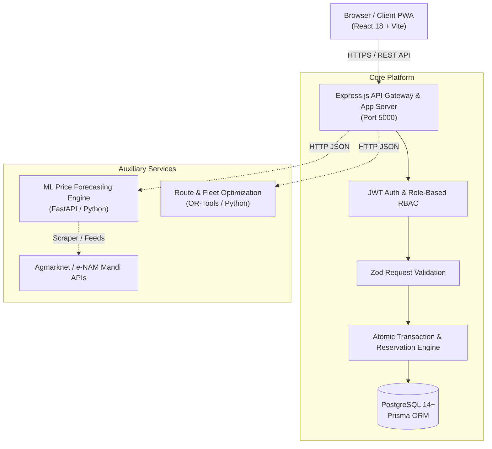
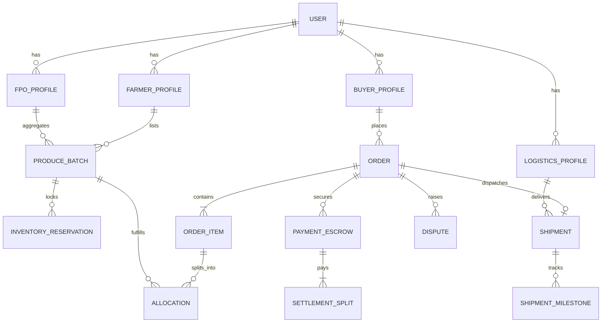
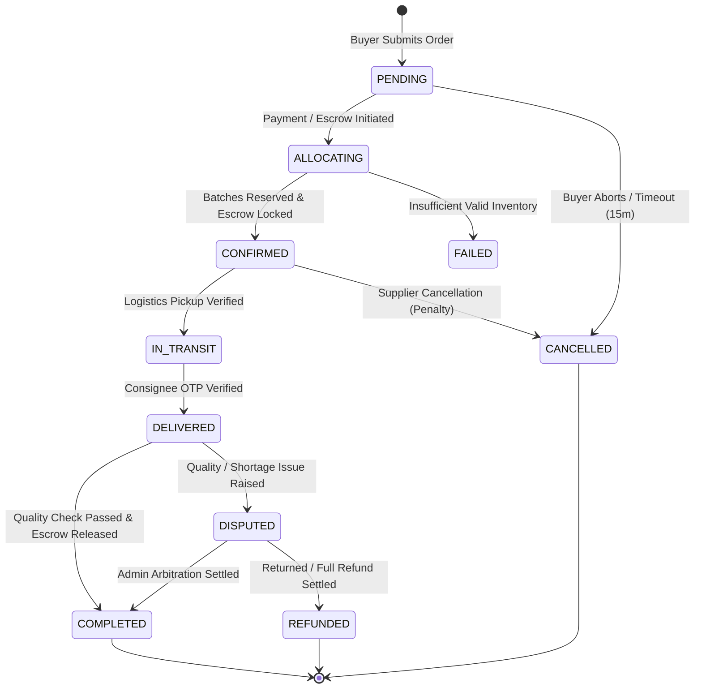
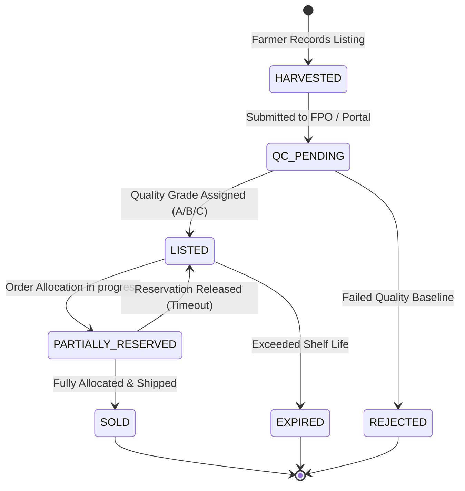
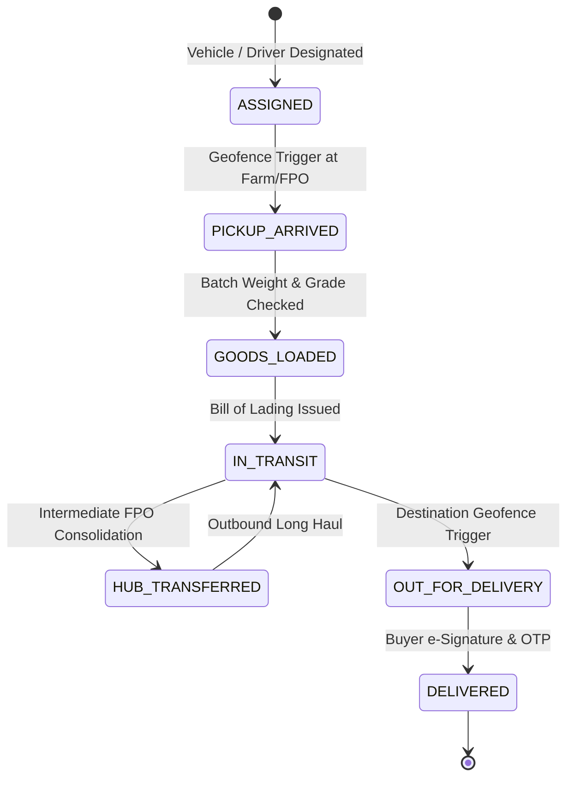

# SasyaVahini — System Architecture Specification

## 1. Executive Architecture Overview

SasyaVahini is engineered as a decoupled modular platform with an Express.js orchestration backend, a React 18 frontend with role-specific dashboards, an ACID-compliant PostgreSQL relational data store accessed via Prisma ORM, and optional auxiliary microservices for Machine Learning price forecasting and vehicle route optimization.



---

## 2. Core Domain Entities & Relational Schema

The data model in `backend/prisma/schema.prisma` is designed around strict transactional consistency, auditable inventory tracking, and transparent financial accounting.



### Entity Responsibilities

1. **User & Profiles**: Multi-tenant identity. Each user has one primary system role (`FARMER`, `FPO`, `BUYER`, `LOGISTICS`, `ADMIN`) mapped to a specialized profile storing KYC, GSTIN, coordinates, and bank details.
2. **ProduceBatch**: Physical agricultural units harvested by farmers or consolidated by an FPO. Tracks quantity, grade, minimum base price, harvest date, shelf life, and GPS location.
3. **InventoryReservation**: Ephemeral reservations created during checkout with strict expiration TTLs (default: 15 minutes). Prevents double-allocation while payment/confirmation is pending.
4. **Order & OrderItem**: Purchase orders submitted by buyers. Supports split fulfillments across multiple batches and suppliers.
5. **Allocation**: The binding record linking a specific `ProduceBatch` to an `OrderItem`, locking the physical kilograms and specifying farmer realization.
6. **Shipment & Milestones**: Physical transit coordination with cold-chain checkpoints, geo-timestamps, and handover signatures.
7. **PaymentEscrow & SettlementSplit**: Multi-party transparent financial breakdown calculated at checkout and disbursed upon verified delivery.

---

## 3. Finite State Machines (FSM)

### 3.1 Order Lifecycle



### 3.2 Produce Batch Lifecycle



### 3.3 Shipment Milestones



---

## 4. Concurrency & Inventory Invariants

To avoid phantom inventory and race conditions in concurrent multi-buyer hackathon demonstrations, the system implements three strict database invariants:

### Invariant 1: Available Stock Formula
$$\text{AvailableQuantity} = \text{TotalQuantity} - \sum(\text{ActiveReservations}) - \sum(\text{CommittedAllocations})$$
Any attempt to allocate or reserve produce must satisfy:
$$\text{RequestedQuantity} \le \text{AvailableQuantity}$$

### Invariant 2: Atomic Checkout via Prisma Transaction
All order reservations must occur inside an atomic `$transaction` with optimistic locking or row-level constraints:
```javascript
// Pattern for inventory reservation
await prisma.$transaction(async (tx) => {
  const batch = await tx.produceBatch.findUnique({
    where: { id: batchId },
  });
  
  if (batch.availableQuantity < requestedQuantity) {
    throw new BadRequestError('Produce batch insufficient stock');
  }

  await tx.produceBatch.update({
    where: { id: batchId },
    data: { availableQuantity: { decrement: requestedQuantity } },
  });

  await tx.inventoryReservation.create({
    data: {
      batchId,
      orderId,
      quantity: requestedQuantity,
      expiresAt: new Date(Date.now() + 15 * 60 * 1000), // 15 mins
    },
  });
});
```

### Invariant 3: Zero-Sum Financial Ledger
For every confirmed order, the total buyer payment must strictly balance the payout ledger:
$$\text{TotalBuyerPaid} = \sum(\text{FarmerPayouts}) + \text{FPOMargin} + \text{LogisticsFee} + \text{PlatformFee} + \text{GST}$$
Every rupee is tracked with immutable credit/debit records.

---

## 5. Security & Authentication Architecture

1. **Token Flow**:
   - Access tokens: Short-lived (15 minutes), signed with `HS256`, stored in client `sessionStorage` (cleared on tab close).
   - Refresh tokens: Long-lived (7 days), stored in client `localStorage`, hashed before storage in PostgreSQL for single-device revocation.
2. **Role-Based Access Control (RBAC)**:
   - Server-side middleware `authorizeRoles('FARMER', 'FPO')` executes on protected route chains before controller invocation.
   - Client-side `<ProtectedRoute roles={['FARMER']} />` prevents unauthorized UI rendering.
3. **Payload Sanitization**:
   - Every mutating endpoint passes through Zod schema validation middleware (`validate(schema)`), stripping unknown attributes and casting types safely.
4. **HTTP Hardening**:
   - Helmet headers configured (CSP, HSTS, frameguard).
   - Strict CORS origin whitelisting.
   - Rate limiting (500 requests/15m globally, 20 requests/15m on authentication endpoints).
