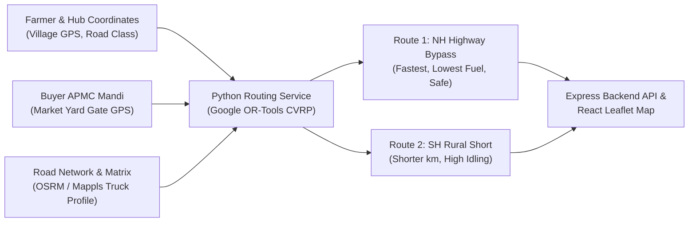

# SasyaVahini — Truckable Route Optimization Engine Specification

## 1. Executive Summary & Objective

In agricultural supply chains across India, **the shortest geographic path is rarely the optimal truck route**.
Narrow, unpaved Major District Roads (MDR) and rural village lanes have:
- Speed breakers, narrow culverts, and cattle blockages forcing trucks to travel at $<25\text{ km/h}$ in 1st/2nd gear.
- Higher fuel burn due to frequent acceleration/braking and idling ($+35\%\text{ to }+45\%$).
- Mechanical vibration and heat buildup that degrades delicate perishables (tomatoes, leafy vegetables, fruits).

Conversely, a **Truckable Commercial Corridor** (4-lane National Highway or State Highway bypass):
- Sustains an average free-flow speed of $50\text{--}60\text{ km/h}$.
- Lowers engine wear, gear shifts, and diesel consumption.
- Cuts transit duration significantly, preserving produce cold-chain viability.

SasyaVahini's route optimization engine solves this multi-criteria problem using **Google OR-Tools (CVRPTW)**, realistic Indian road hierarchy models, and physical diesel burn formulas.

---

## 2. Mathematical Formulation

### 2.1 Multi-Criteria Objective Function
$$\min \mathbf{Z} = C_{\text{fuel}} + C_{\text{time}} + C_{\text{perishability}} + C_{\text{toll}}$$

Where:
* $C_{\text{fuel}} = \text{Fuel Consumed (L)} \times \text{Diesel Rate (₹95.00/L)}$
* $C_{\text{time}} = \text{Driver Allowance} \times \Delta t$
* $C_{\text{perishability}} = \text{Crop Value (₹)} \times \text{Decay Rate} \times \Delta t$
* $C_{\text{toll}} = \text{Electronic FASTag Toll Fees}$

### 2.2 Load-Adjusted Fuel Consumption Physics
$$\text{Mileage}_{\text{eff}} = \mathbf{M_{\text{base}}} \times \left(1 - \alpha \times \frac{\mathbf{W_{\text{load}}}}{\mathbf{W_{\text{cap}}}}\right) \times \mathbf{\beta_{\text{road}}} \times \mathbf{\gamma_{\text{traffic}}}$$

Where:
* $M_{\text{base}}$: Base unladen vehicle mileage ($4.5\text{ km/L}$ for Light Commercial Vehicles / Tempo; $3.5\text{ km/L}$ for 10-Tonne Trucks).
* $\alpha$: Payload fuel penalty coefficient ($0.28$).
* $\beta_{\text{road}}$: Road Quality Factor:
  * National Highway (4-lane): $1.00$
  * State Highway (2-lane): $0.88$
  * Rural Paved Road: $0.74$
  * Unpaved Village Lane: $0.62$
* $\gamma_{\text{traffic}}$: Traffic Congestion / Peak Hours Factor:
  * Free-flow: $0.92\text{--}1.00$
  * Urban Mandi Rush: $0.70\text{--}0.78$

$$\text{Fuel Burn (L)} = \sum_{\text{legs}} \frac{\text{Distance}_i}{\text{Mileage}_{\text{eff}, i}} + (\text{Idling Hours} \times 1.8\text{ L/hr})$$

---

## 3. Data Providers & Architecture

1. **Routing Graphs**: OpenStreetMap & OSRM (baseline) + Mappls Truck Routing (India commercial profile with axle weight & no-entry clearances).
2. **Combinatorial Optimization**: Google OR-Tools `pywrapcp.RoutingModel` (`PATH_CHEAPEST_ARC` + `GUIDED_LOCAL_SEARCH`).
3. **Storage**: PostgreSQL + Prisma records route geometry, distance, fuel statistics, and OTP delivery verification.

---

## 4. Benchmark Scenario Comparison: Junnar-Manchar-Shirur to Pune APMC

| Metric | Primary Route (NH-60 Corridor) | Alternative Route (SH-54 Direct) | Impact / Verdict |
| :--- | :--- | :--- | :--- |
| **Road Distance** | **96.0 km** | 82.5 km *(13.5 km shorter)* | Highway is slightly longer on map. |
| **Road Hierarchy** | **75% 4-Lane NH Bypass** | 50% Rural / 38% State Highway | Highway bypass avoids village speed bumps. |
| **Transit Speed** | **52 km/h avg** | 26 km/h avg | Highway avoids low-gear bottlenecks. |
| **Total Duration** | **1h 50m (110 min)** | 3h 05m (185 min) | **Saves 75 minutes of driver & transit time.** |
| **Effective Mileage** | **4.2 km/L** | 2.9 km/L | Low-gear idling severely hurts rural mileage. |
| **Fuel Burned** | **23.4 Litres** | 29.8 Litres | **Saves 6.4 Litres of diesel.** |
| **Fuel Cost** | **₹2,223** (@ ₹95/L) | ₹2,831 (@ ₹95/L) | **Saves ₹608 in net fuel expenses.** |
| **Produce Spoilage** | **Low (Optimal Cold-Chain)** | Elevated (Vibration & Delay) | Vital for perishable produce (tomatoes, greens). |

**Conclusion:** **The 96 km Highway Corridor is overwhelmingly superior.** It cuts delivery time by 1 hour 15 minutes, saves ₹608 in fuel, and prevents cargo damage.
